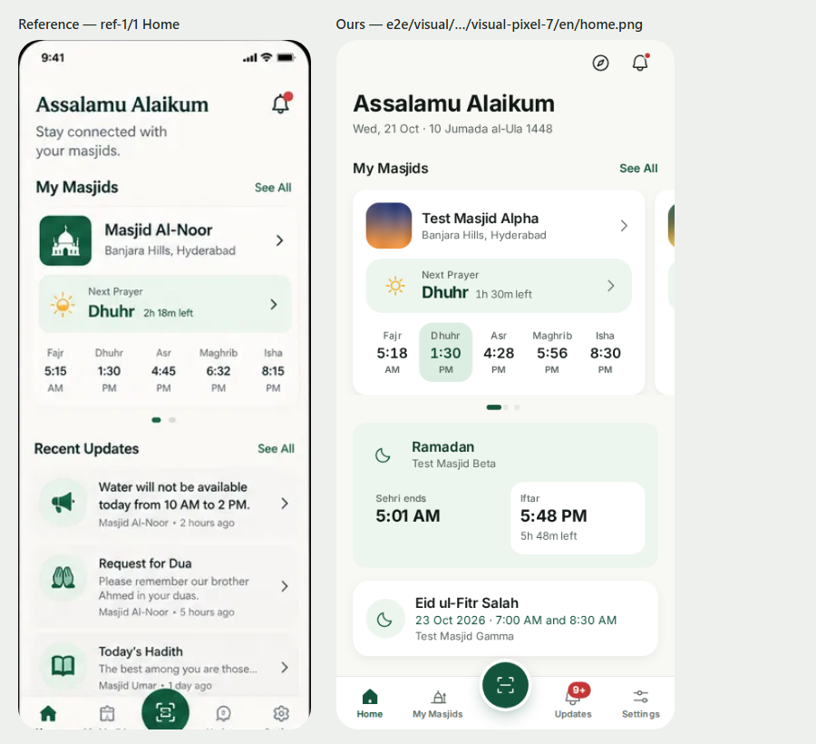
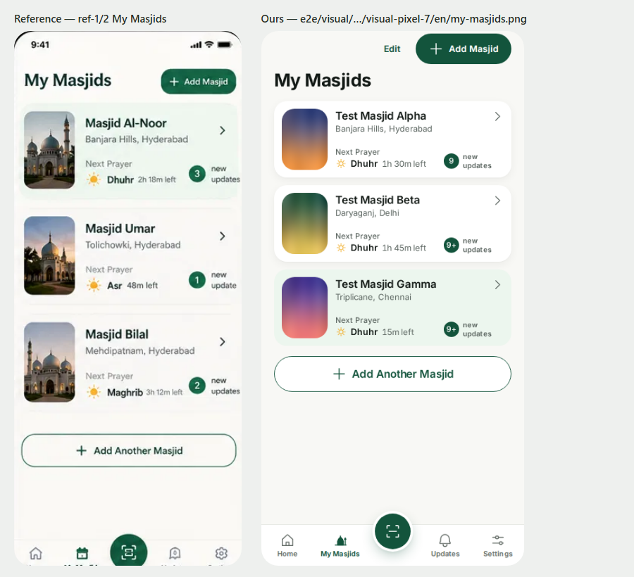
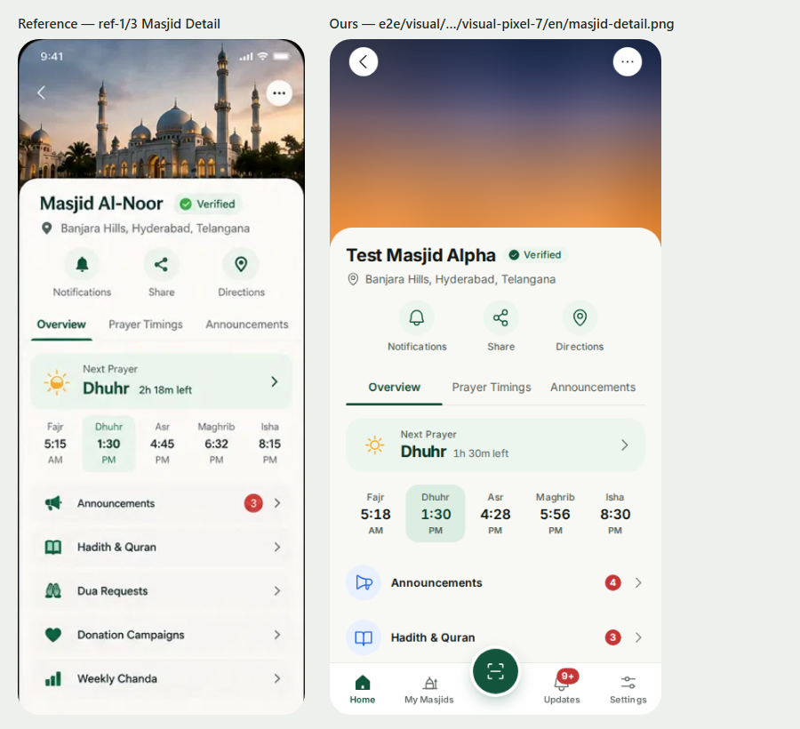
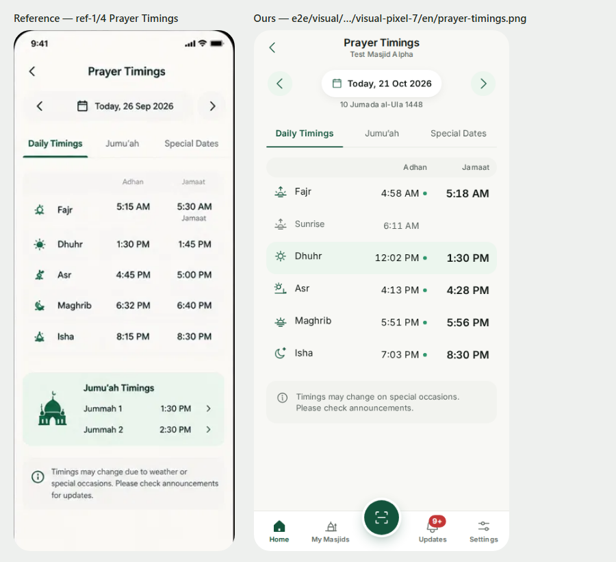
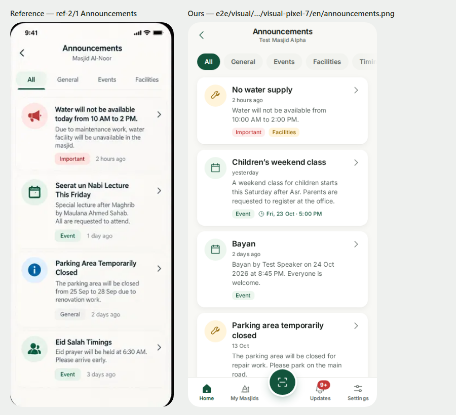
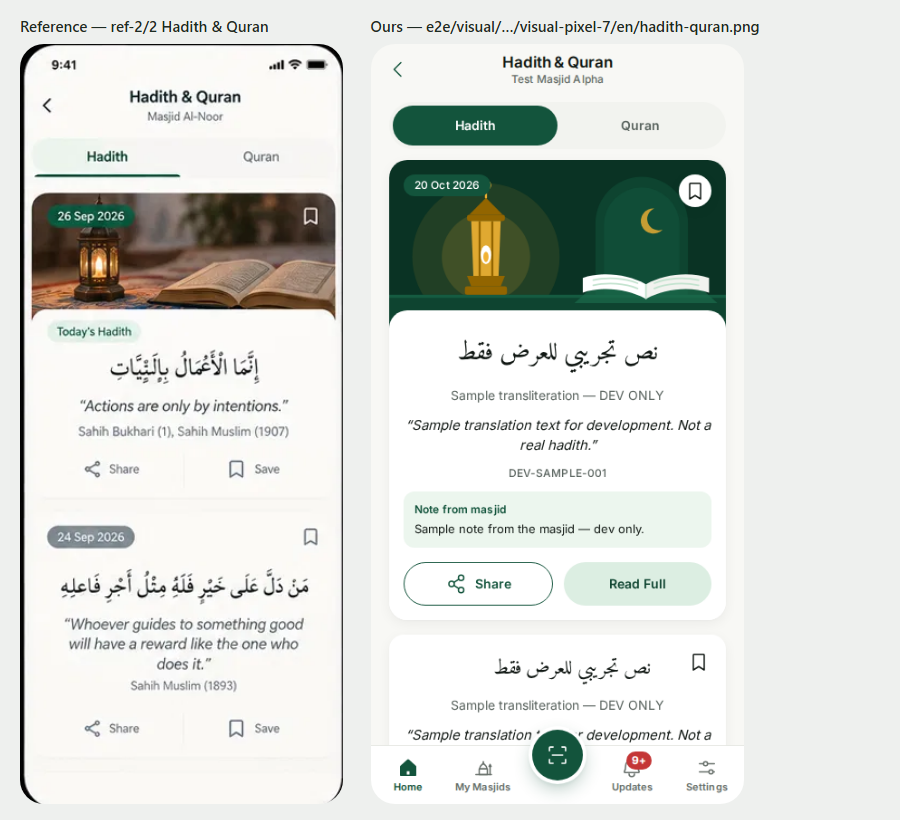
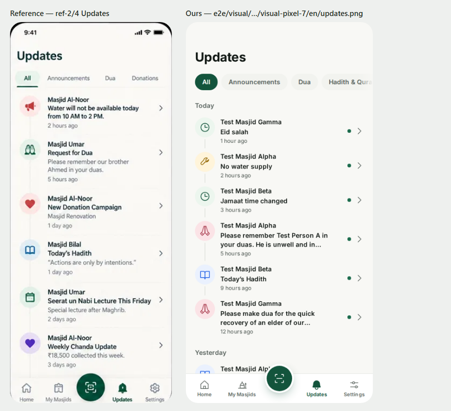
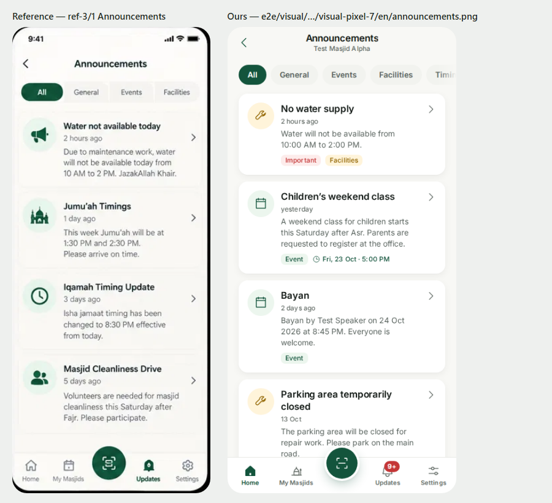
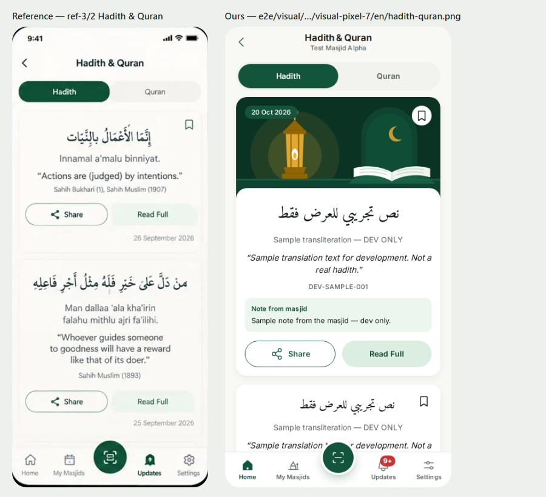
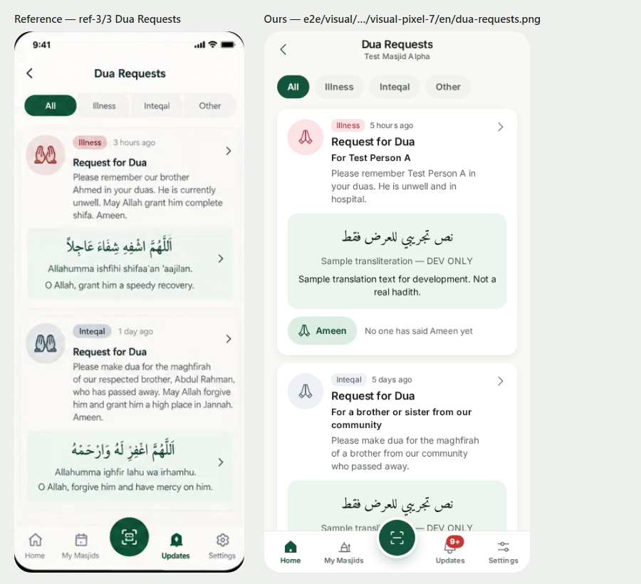

# PHASE 02 REPORT — Musalli app core (follow, timings, feed, offline, install)

> **Status: DONE — FINAL (27 Oct 2026).** The owner tested the Phase 02 checks on staging `cdd39fa`, including a
> low-end device: "works perfectly, good to go; looks good on low-end devices; no design changes".
>
> Before sign-off: One deviation the owner should know first: the real-screen
> motion budget (08 §8) is **not met yet** — F46, the first task of Phase 03 (§5).

**Date:** 27 Oct 2026 · **Commit range:** `f7ef8a9..cdd39fa` on `main` (Phase 02 started 22 Oct 2026) ·
**Staging URLs:** app https://app-staging.almasjids.com · admin https://admin-staging.almasjids.com ·
**Deployed release:** `cdd39fa` — signed staging manifest from CI run 40451892203 (green 27 Oct 2026 05:17 UTC), pulled by the staging deploy timer; both APIs report `cdd39fa` with `db: ok, redis: ok` (checked 27 Oct 2026 16:23 UTC)

## 1. Summary

A musalli can install the app, onboard in English, Hindi, Urdu (right-to-left) or Telugu, and follow masjids by QR
scan, follow link or 8-character code — without an account (a random device id and secret only). Home shows the next
jamaat with a live countdown, the day's five prayers, Ramadan and Eid cards and recent updates. My Masjids, Masjid
Detail, Prayer Timings (date stepper, Jumu'ah, special dates), the merged Updates timeline, Announcements, Hadith &
Quran and Dua Requests with Ameen (once per device, queued offline, Background Sync on Android) all work against the
public API with the dev/staging seed. Settings changes language and Brother/Sister on the server; Clear all data
deletes the device record and everything the phone kept. The app renders from its cache offline, with an offline
banner — also when the phone is connected but has no internet.

## 2. Tasks

| Task | Status | Key files | Tests / evidence |
|---|---|---|---|
| T2.1 Domain logic | ✅ | `packages/domain/src/{prayer,hijri,follow-code,time,money,countdown}.ts` | 146 tests, 100 % lines/branches/functions; golden prayer times 7 cities × 6 dates (Aladhan URLs) ±1 min; property tests (DECISIONS #90) |
| T2.2 Public API + seed | ✅ (CDN HIT waits for O23) | `packages/api/src/routes/public.ts`, `packages/db/src/seed/` | every 03 §3 endpoint of the phase as `mc_public` (`public-routes.int.test.ts`); explain tests on 100k items (#91) |
| T2.3 Client data layer | ✅ | `apps/app/src/lib/{device,api,query}/` | MSW poller/invalidation tests, corrupt IndexedDB reset (#92) |
| T2.4 Onboarding (A1) | ✅ | `features/onboarding/` | journey 1 `onboarding.spec.ts`: 4 locales, and via `/m/:code` in 4 locales with Home's countdown; offline registration (#93, #103) |
| T2.5 Scan / code / follow / landing | ✅ | `features/follow/` | journey 2 `scan.scan.spec.ts` (fake camera, Chromium), `follow.spec.ts` (#94) |
| T2.6 Home (A2) | ✅ (LCP not measured — §5) | `features/home/` | `home.spec.ts` (pinned clock across the jamaat start), view-model tests (#95) |
| T2.7 My Masjids (A3) | ✅ | `features/masjids/` | `my-masjids.spec.ts` (reorder keyboard/menu/drag, unfollow + undo) (#96) |
| T2.8 Masjid Detail (A5) | ✅ (morph deferred — §5) | `features/masjid/MasjidDetailScreen.tsx` | `masjid-detail.spec.ts` (#97) |
| T2.9 Prayer Timings (A6) | ✅ | `features/masjid/TimingsScreen.tsx` | `timings.spec.ts`, rows = domain output (#98) |
| T2.10 Updates (A13) | ✅ | `features/updates/` | journey 3 `updates.spec.ts`, fling `updates.perf.spec.ts` (#99) |
| T2.11 Announcements / Hadith & Quran / Dua | ✅ | `features/content/` | journey 8 `content.spec.ts` (Ameen once, also offline), Arabic in Amiri never mirrored (#100) |
| T2.12 Settings & item landing | ✅ | `features/settings/`, `PostLanding.tsx` | journey 12 `settings.spec.ts` (server record deleted) (#101) |
| T2.13 PWA / offline | ✅ | `src/sw/sw.ts`, `lib/{reachability,launch,storage,sw-protocol}.ts` | journey 4 `offline.spec.ts`; Android link capture = owner check 2.20 (#102) |
| T2.14 Quality gates | ✅ with deviations (§5) | `e2e/visual/`, `scripts/visual.mjs`, `e2e/app/screens.perf.spec.ts` | 80 visual baselines; real-screen perf `fixme` (F46) (#103) |

## 3. Verification results

| Gate | Result | Numbers |
|---|---|---|
| Typecheck / lint / format / i18n | ✅ | 0 warnings (CI, `cdd39fa`) |
| Unit + component (coverage gates) | ✅ | app 155 (90 % lines), ui 243, domain 146 (100 %), shared, i18n, api 115, config — CI coverage gates green |
| DB policy matrix / privileges / explain | ✅ | CI green (`pnpm db:test` + `test:int`: api 188 locally) |
| Security scans | ✅ | gitleaks, osv-scanner and `pnpm audit` with **no ignores** (F45 closed), Semgrep, hadolint, Trivy — CI green |
| E2E (Pixel 7 / iPhone 14) | ✅ | CI `cdd39fa`: **224 passed, 0 failed, 0 flaky**, 28 skipped by design; admin passkey/test-hooks 8 passed; journeys 1–5, 8, 12 on both phones — except journey 2 (Chromium only, no fake camera in WebKit) and journey 4's worker case (Chromium only) |
| Accessibility (axe) | ✅ | `expectAxeClean` in every screen spec except the Scan modal (§5); serious/critical 0 |
| Visual regression | ✅ (CI) | 10 screens × en/hi/ur/te × Pixel 7 + iPhone 14 = 80 baselines in the pinned Playwright Linux image; two identical local re-runs |
| Bundle budgets | ⚠️ deviation | musalli initial JS **185.3 kB** gz (phase target ≤ 170; limit 186 per owner O24) |
| Lighthouse (mobile, CI built stack) | ✅ (CI budgets, median of 5) | `/` (onboarding) — Home with masjids not measured (§5) |
| Motion perf traces | ⚠️ partial | navigator push/pop + swipe and the Updates fling meet 08 §8 in CI; real screens: F46 (§5) |
| phase-verifier | ✅ after fixes | first run FAIL (27 Oct): typecheck, CI e2e (rate limit in a test helper), journey 1 scope, Qibla placeholder in production, side-by-side images, doc gaps — all fixed or declared (#103) |
| security-reviewer | 0 HIGH / 0 MEDIUM open | H1 (template injection in link previews) and M1 (local wipe) fixed and verified; L1, L2, L4, L7 fixed; L3, L5, L6, L8 justified (#103) |

## 4. Screenshots and reference comparison

All screens, all locales, both phones: `e2e/visual/__screenshots__/visual-{pixel-7,iphone-14}/{en,hi,ur,te}/`
(`onboarding-welcome`, `home`, `my-masjids`, `masjid-detail`, `prayer-timings`, `updates`, `announcements`,
`hadith-quran`, `dua-requests`, `settings`).

Side by side with `docs/design-references` (reference phone left, ours right):

| Reference | Composite | Notes |
|---|---|---|
| ref-1/1 Home |  | Same structure. By spec: the subtitle is the Gregorian · Hijri date (07 A2); bell top right; the seed's Ramadan / Eid cards sit above Recent Updates |
| ref-1/2 My Masjids |  | Same; thumbs are ThumbHash gradients (no real photos in the test stack) |
| ref-1/3 Masjid Detail |  | Same; Donation Campaigns / Weekly Chanda rows come with Phase 5; the tab bar stays visible |
| ref-1/4 Prayer Timings |  | Same: stepper, three tabs, Adhan + Jamaat columns, info note |
| ref-2/1 Announcements |  | Category icons and cards |
| ref-2/2 Hadith & Quran |  | Placeholder content only (CLAUDE.md §2.3) |
| ref-2/4 Updates |  | Timeline with icon circles, connector line, chips, day headers |
| ref-3/1 Announcements |  | as ref-2/1 |
| ref-3/2 Hadith & Quran |  | as ref-2/2 |
| ref-3/3 Dua Requests |  | Request cards with the dua box; our Ameen row (07 A9) |

Urdu baselines are mirrored correctly (e.g. `visual-iphone-14/ur/home.png`); the baselines found two Urdu/RTL bugs
(countdown letters not joined and "30" shown as "03"; English admin text with its "…" first) — fixed (#103).

## 5. Deviations from spec (all in DECISIONS #103)

- **Real-screen motion budget (08 §8) not met — F46.** The real-screen perf spec found taps of 100–130 ms at 4× CPU.
  T2.14 fixed the causes it found (forced layouts in ChipGroup / UnderlineTabs / Masjid Detail, the navigator context
  re-rendering every screen, a new `Date` per render defeating memos, synchronous mounting of pushed screens) → about
  50–75 ms, still over the limits (long tasks > 50 ms, 6–13 % dropped frames, a forced layout on sheet open). The spec
  is `test.fixme`; F46 is Phase 03's first task, judged on a low-end phone (O16, with F20).
- **Initial JS 185.3 kB > 170 kB** — owner rule "quality over bundle size" (O24); F42/F43 in Phase 9.
- **T2.6 LCP of a Home with masjids not measured** — CI Lighthouse covers `/` on fresh storage; with F42 in Phase 9.
- **T2.2 CDN HIT on staging** — waits for the Cloudflare cache rule (O23); the Nightly check stays red until then.
- **Shared-element morph (08 §3.5, progressive)** — F44, Phase 9 polish; owner guide 2.8 says so.
- **Journey 2 on Chromium only** (WebKit has no fake camera); the iPhone covers the Enter-code path.
- **Scan modal without an axe pass** — with F46.
- **Visual projects bypass CSP** — only because Playwright's screenshot styles are inline; every other project keeps
  the CSP guard.

## 6. Known limitations / follow-ups

Deferred with DECISIONS #103: F46 (Phase 03 first, includes F20), F1 (Node 26 after 28 Oct), F22 admin icons
(Phase 3), F18 / F42 / F43 / F44 (Phase 9). Security LOW items L3 (Phase 8), L5 (= O8), L6 (Phase 5). Owner items:
O23 (Cloudflare cache rule), O8 (Turnstile keys on staging), O16 (low-end phone), Grievance Officer details before
launch.

## 7. What the owner should test now

`owner/PHASE_TESTING_GUIDE.md` → Phase 02 (2.1–2.21, including 2.19a "Android back closes sheets"; 2.8 updated — no
morph yet; 2.14 and 2.20 extended in T2.13). Seed data on staging: follow codes **TESTA001** (Hyderabad), **TESTB002**
(Delhi, Ramadan mode on), **TESTC003** (Chennai, Eid in 2 days) — or open
`https://app-staging.almasjids.com/m/TESTA001` on the phone. The staging worker refreshes the seed daily, so the
Ramadan / Eid cards and "hours ago" stay current. Staging is a dev/staging build: the Qibla button and the
"Coming soon" Notifications row are visible there on purpose (hidden in production).
